# Benchmark Estratégico Compass vs BRIDS: La Ilusión del Corretaje Tecnológico, la Trampa del Split del 81% y Lecciones de Retención

> [!NOTE]
> **Propósito de Investigación Objetiva:** Compass, Inc. (NYSE: COMP) se posicionó ante Wall Street no como una agencia inmobiliaria tradicional, sino como una empresa de software (*Agent Cloud*) capaz de comandar múltiplos tecnológicos. Con más de \$1,500 millones de dólares de capital riesgo (respaldada principalmente por el *SoftBank Vision Fund*), Compass se convirtió en la correduría número 1 de EE.UU. por volumen de ventas. Sin embargo, su estructura económica reveló una contradicción esencial: los agentes retienen más del 81% de las comisiones y consideran el software un servicio secundario, provocando más de \$1,500 millones en pérdidas acumuladas. Este análisis desglosa esa dinámica con rigor empírico.

---

## 1. Qué Logró Compass: Innovación Real y Escala de Red

1. **La Plataforma Operativa Unificada para Agentes (*Agent Cloud*):** Compass identificó que los agentes inmobiliarios independientes utilizaban entre 6 y 10 herramientas desconectadas (CRM, marketing por correo, diseño de folletos, análisis de precios comparativos CMA, gestión de firmas y facturación). Desarrolló un entorno integrado en la nube que permite a los agentes de alto rendimiento gestionar todo el ciclo de vida de sus clientes en una sola aplicación móvil y web.
2. **Construcción de una Marca de Prestigio en Mercados de Lujo:** A diferencia de Redfin (enfocada en descuento y ahorro), Compass entendió la psicología del sector inmobiliario de alta gama en Nueva York, Los Ángeles, Miami y San Francisco: estética editorial sofisticada, señalización urbana premium y estatus social.
3. **Red de Listados Exclusivos (*Private Exclusives*):** Compass creó un inventario interno fuera del MLS (*off-market*), permitiendo a sus clientes vender con discreción y otorgando a sus agentes una ventaja competitiva de captación frente a portales públicos como Zillow ([Mike DelPrete Analysis on Compass Exclusives](https://www.mikedp.com)).

---

## 2. La Autopsia del Modelo: La Trampa de los Splits y el Peso de los Costes SG&A

A pesar de su retórica tecnológica, los reportes auditados ante la SEC ([SEC Form 10-K Compass, Inc. CIK #0001563190](https://www.sec.gov/edgar/browse/?CIK=0001563190)) demuestran que Compass no opera con la economía unitaria de una empresa de software:

### A. La Trampa del Split de Comisiones (*Commission Split Trap*)
En una empresa SaaS típica, el coste de los bienes vendidos (COGS) es inferior al 20%, lo que permite márgenes brutos del 80% o superiores. En Compass:
* **El 80%–82% de Cada Dólar Ingresado se va al Agente:** En 2021, 2022 y 2023, el coste directo de ingresos (*commissions and other related expenses*) absorbió entre el **80.5% y el 81.8% de los ingresos totales**.
* **Margen Bruto de Agencia Tradicional:** El margen bruto residual de Compass es de apenas **18% a 19%**, exactamente idéntico al de intermediarios tradicionales como Anywhere Real Estate (Coldwell Banker/Century 21).

### B. El Subsidio Agresivo de Captación con Capital de SoftBank
Para arrebatar los mejores equipos de agentes a competidores tradicionales, Compass utilizó cientos de millones de dólares en incentivos en efectivo y concesiones de acciones (*equity grants*):
* **Fuga de Capital:** Los gastos de ventas, marketing y administración general (SG&A) superaron constantemente el margen bruto generado, acumulando pérdidas masivas.
* **El Congelamiento Forzado de 2022:** Con la subida de tipos de interés y el desplome de su cotización bursátil (de \$18 en su salida a bolsa en abril de 2021 a menos de \$2.50 en 2022), el CEO **Robert Reffkin** se vio obligado a eliminar completamente los bonos de captación en efectivo y recortar cientos de puestos de ingeniería de software para evitar el agotamiento de su tesorería ([RealTrends Coverage on Compass Financial Pivot](https://www.realtrends.com)).

---

## 3. Métricas Financieras Auditadas: SEC Form 10-K (2021–2023)

Fuente: Comisión de Bolsa y Valores de EE.UU. ([SEC EDGAR: Compass, Inc. CIK #0001563190](https://www.sec.gov/edgar/browse/?CIK=0001563190)):

| Métrica Consolidada | FY 2021 (10-K) | FY 2022 (10-K) | FY 2023 (10-K) | Observaciones de Auditoría |
| :--- | :--- | :--- | :--- | :--- |
| **Ingresos Totales (Revenue)** | \$6,422M | \$6,019M | \$4,885M | Caída por contracción de transacciones nacionales |
| **Gasto en Comisiones de Agentes** | \$5,200M | \$4,888M | \$3,978M | **81.4% promedio** entregado directamente a agentes |
| **Utilidad Bruta (Gross Profit)** | \$1,222M | \$1,131M | \$907M | Margen bruto estructuralmente bajo (~18.5%) |
| **Gastos Operativos (SG&A + I+D)** | \$1,716M | \$1,732M | \$1,228M | Elevada estructura de personal y oficinas físicas |
| **Pérdida Neta GAAP** | \$(494.1)M | \$(601.5)M | \$(321.3)M | **\$(1,416.9)M acumulados** en 3 ejercicios |
| **Déficit Acumulado Histórico** | \$(1,678)M | \$(2,280)M | \$(2,601)M | Más de **\$2,600 millones** quemados desde fundación |

---

## 4. Análisis Crítico de Mike DelPrete sobre Compass

El analista de tecnología inmobiliaria **Mike DelPrete** resume la encrucijada de Compass ([Mike DelPrete Analysis: Compass & The Brokerage Model](https://www.mikedp.com)):
> *"Compass demostró que la tecnología no cambia la ley de gravedad del corretaje: el poder en el sector inmobiliario de lujo reside en los agentes, no en la marca ni en el software. Cuando una plataforma gasta millones en construir herramientas pero tiene que ceder el 82% de sus ingresos para retener a los productores, la tecnología no es una ventaja de margen; es simplemente un coste operativo más."*

---

## 5. Matriz Crítica: Qué Adoptar vs Qué Descartar para BRIDS

```mermaid
flowchart TD
    subgraph Compass ["Compass: Corretaje Tecnológico de Alto Split"]
        C1["Software Agent Cloud Propietario"] --> C2["Agentes Exigen el 81% de Comisión"]
        C2 --> C3["Margen Bruto de Solo el 18.5%"]
        C3 --> C4["Pérdidas GAAP Masivas de >$1.4B"]
    end

    subgraph BRIDS ["BRIDS: Infraestructura SaaS Pura en Solana"]
        B1["Software de Sindicación para Sponsors"] --> B2["Cobro de Tarifa de Emisión ($4/fracción)"]
        B2 --> B3["Margen Bruto SaaS Superior al 80%"]
        B3 --> B4["Cero Subsidio de Agentes o Intermediarios"]
    end

    style C4 fill:#f8d7da,stroke:#f5c6cb,color:#721c24
    style B4 fill:#d4edda,stroke:#c3e6cb,color:#155724
```

### ✅ Qué Debemos Adoptar de Compass
* **Herramientas de Estatus y Calidad de Presentación para Sponsors:** Los promotores inmobiliarios (*Sponsors*) valoran enormemente la elegancia visual y la simplicidad en la presentación de sus cuadernos de venta. Los paneles de sindicación de BRIDS deben ofrecer la misma sobriedad visual y claridad analítica que *Compass Workspace*.
* **Portal de Gestión Centralizada de Documentación:** Centralizar en un único repositorio digital los contratos de SPV, reportes de peritaje físico, pólizas de seguro y cuentas de custodia.

### ❌ Qué Debemos Descartar de Compass
* **Competir en el Negocio de Corretaje Tradicional:** Jamás contratar agentes inmobiliarios comerciales ni depender de la intermediación comisionista como modelo de negocio central.
* **Subvencionar la Captación de Usuarios con Pérdidas Operativas:** Evitar a toda costa ofrecer dinero o subsidios artificiales para captar sponsors. El valor de BRIDS debe ser el ahorro real de tiempo, costes notariales y liquidación atómica en Solana.

---

## 6. Las Preguntas Difíciles que BRIDS Debe Responder (Contra-Tesis)

> [!WARNING] Desafíos Reales de Retención y Valor de Software para BRIDS
> 1. **La Paradoja de la Desintermediación Post-Captación:** Compass sufrió para retener agentes porque, una vez que el agente construía su clientela, amenazaba con marcharse a otra correduría que le ofreciera un split más alto. En BRIDS: **¿Qué impide que un desarrollador inmobiliario use BRIDS para financiar su primer proyecto y, una vez que ha construido la base de datos de inversores, emita sus siguientes proyectos por su cuenta o fuera de la plataforma para no pagar las tarifas de BRIDS?**
> 2. **El Valor Real del Software vs Comoditización:** Compass gastó cientos de millones en software que los agentes consideraron un "accesorio intercambiable". Si BRIDS solo ofrece tokenización en Solana y contratos inteligentes estándar de Metaplex Core, ¿qué impide que un competidor copie los contratos y ofrezca el servicio a precio de coste cero? BRIDS debe crear valor retenible real: cumplimiento regulatorio automatizado, pasarelas de pago y distribución institucional que no puedan ser comoditizadas.
> 3. **El Coste de Venta B2B a Sponsors Inmobiliarios:** Vender software a promotores inmobiliarios tradicionales es notoriously lento (ciclos de venta de 6 a 12 meses, burocracia legal y aversión tecnológica). Si el equipo de ventas de BRIDS pasa meses negociando con un promotor para tokenizar un solo edificio, **¿cuál será el CAC B2B real y cuántos deals al año se necesitan para ser rentables?**
