# Benchmark Estratégico Fundrise vs BRIDS: eREITs, Interval Funds, la Trampa de las Puertas de Liquidez y el Espejismo de los Tokens

> [!NOTE]
> **Propósito de Investigación Objetiva:** Fundrise, LLC es el referente absoluto en la democratización del acceso al capital inmobiliario para inversores minoristas en EE.UU., gestionando más de **\$3,300 millones de dólares en activos (AUM)** para más de 385,000 inversores activos. Fundada por **Ben Miller**, la compañía aprovechó el Título IV de la Ley JOBS (Regulation A+ Tier 2) y la Ley de Sociedades de Inversión de 1940 (*Interval Funds*) para crear una experiencia de usuario sobresaliente. Este documento analiza sus logros genuinos, la tensión irresoluble entre activos inmobiliarios ilíquidos y expectativas de liquidez minorista, y desafía críticamente las suposiciones de BRIDS sobre la liquidez en blockchain.

---

## 1. Qué Logró Fundrise: El Estándar de Oro en Adquisición Minorista

1. **La Democratización Radical del Ticket Mínimo (\$10 Dólares):** Antes de Fundrise, invertir en proyectos inmobiliarios institucionales (desarrollos multifamiliares, naves logísticas) requería ser inversor acreditado con tickets mínimos de \$25,000 a \$100,000. Fundrise redujo la barrera de entrada a solo **\$10 dólares**, permitiendo que cualquier ciudadano participe mediante transferencias ACH automatizadas.
2. **Onboarding Digital y Abstracción Total de Fricciones:** La aplicación móvil de Fundrise ofrece una experiencia impecable: asignación automática según perfil de riesgo (Crecimiento vs Ingreso), reinversión automática de dividendos (DRIP), integración bancaria instantánea con Plaid y generación anual consolidada del Formulario 1099-DIV.
3. **Comunicación Transparente y Narrativa Directa del Fundador:** El CEO Ben Miller construyó una relación de confianza institucional a través de podcasts periódicos (*Onward*) y cartas trimestrales donde explica con honestidad la coyuntura macroeconómica y el posicionamiento de cartera ([Fundrise Investor Updates](https://fundrise.com/investor-update)).

---

## 2. La Tensión Estructural: Fondos Ciegos y Puertas de Reembolso (*Redemption Gates*)

A pesar de su éxito, el modelo de Fundrise afronta un conflicto fundamental entre la naturaleza de los inmuebles y la psicología del inversor minorista:

### A. La Trampa del Fondo Ciego (*Blind Pool*)
El inversor en Fundrise no elige qué edificio, centro logístico o complejo residencial específico desea comprar. Adquiere participaciones en un fondo ciego (*eREIT* o *Flagship Fund*):
* **Falta de Soberanía:** El inversor no puede auditar el desempeño de un activo individual ni decidir vender un edificio específico que esté rindiendo mal. Su capital queda mezclado con decenas de activos heterogéneos.
* **Comisión Continua del 1.00% Anual sobre AUM:** Fundrise cobra un 0.15% de asesoría de inversión a través de su filial registrada ante la SEC ([Fundrise Advisors, LLC - CRD #170720](https://adviserinfo.sec.gov)) más un 0.85% de gestión de activos. Esta comisión fija del **1.00% anual** se descuenta del patrimonio del fondo independientemente de si los inmuebles ganan o pierden valor.

### B. El Mecanismo de las Puertas de Liquidez (5% Trimestral)
El sector inmobiliario es intrínsecamente ilíquido: vender un edificio comercial lleva entre 6 y 12 meses. Sin embargo, una aplicación móvil genera la ilusión psicológica de que el dinero puede retirarse en cualquier momento.
Para evitar un pánico bancario (*run on the bank*), las escrituras constitutivas de los eREITs y de su fondo por intervalos ([SEC Form N-2 / Form 1-A en EDGAR](https://www.sec.gov/edgar/browse/?CIK=0001777677)) estipulan reglas estrictas de rescate:
1. **Límite Máximo de Reembolsos:** Las recompras trimestrales están limitadas estatutariamente a un **máximo del 5.0% del valor liquidativo (NAV) del fondo** en cualquier trimestre (o 0.5% mensual en ciertos vehículos).
2. **Prorrateo y Esperas Prolongadas:** Durante la subida de tipos de interés de 2022–2023, cuando miles de inversores solicitaron retirar su capital simultáneamente, Fundrise no pudo atender todas las solicitudes. Los inversores quedaron atrapados en colas de espera con pagos parciales prorrateados durante múltiples trimestres.
3. **La Filosofía de Ben Miller sobre la Iliquidez:** En su ensayo fundacional *"Qué esperar de Fundrise en una crisis financiera"* ([Fundrise Crisis Strategy](https://fundrise.com/investor-update/410/what-to-expect-from-fundrise-in-a-financial-crisis)), Miller declaró sin rodeos:
   > *"El sector inmobiliario privado no es una cuenta corriente ni una acción de bolsa de alta frecuencia. Si los inversores pudieran retirar todo su capital durante una caída del mercado, nos veríamos forzados a malvender propiedades excelentes con descuentos absurdos. Las restricciones de liquidez no son un fallo del sistema: son el escudo que protege el patrimonio a largo plazo."*

---

## 3. Registros Regulatorios Auditados ante la SEC (EDGAR)

Fuentes oficiales en la SEC:
* [Fundrise Growth eREIT, LLC (CIK #0001645583)](https://www.sec.gov/edgar/browse/?CIK=0001645583) — Emisión bajo Regulation A+ Tier 2.
* [Fundrise Flagship Real Estate Fund (CIK #0001777677)](https://www.sec.gov/edgar/browse/?CIK=0001777677) — Registrado como *Interval Fund* bajo la Ley de Sociedades de Inversión de 1940.

| Parámetro Operativo | eREITs Tradicionales (Reg A+ Tier 2) | Fundrise Flagship Fund (Interval Fund 1940 Act) |
| :--- | :--- | :--- |
| **Límite de Captación Anual** | Hasta \$75M por periodo de 12 meses (Regla 251(a)(2)) | Oferta continua sin tope legal anual predefinido |
| **Inversores Habilitados** | Acreditados y No Acreditados (Límite: 10% ingresos/patrimonio) | Abierto a inversores minoristas a nivel nacional |
| **Frecuencia de Tasación NAV** | Trimestral (estimada internamente por el asesor) | Diaria (supervisada por junta independiente) |
| **Política de Reembolso** | Trimestral, sujeta a discreción de la directiva y cupo del 5% | Ofertas de recompra obligatorias del 5% trimestral |
| **Carga Base Anual** | 1.00% sobre AUM (0.15% Asesoría + 0.85% Gestión) | 1.00% sobre AUM + gastos operativos adicionales |

---

## 4. Matriz Crítica: Qué Adoptar vs Qué Descartar para BRIDS

```mermaid
flowchart TD
    subgraph Fundrise ["Fundrise: Fondo Ciego eREIT"]
        F1["Inversión Minorista ($10 Mínimo)"] --> F2["Dinero Agrupado en Pool Ciego"]
        F2 --> F3["Comisión Fija del 1% Anual sobre AUM"]
        F3 --> F4["Puertas de Liquidez (Máx. 5% Trimestral)"]
        F4 --> F5["Inversores Bloqueados en Colas de Retiro"]
    end

    subgraph BRIDS ["BRIDS: Activo Específico en Delaware SPV"]
        B1["Inversor Elige el Inmueble Específico"] --> B2["SPV Delaware Segregada por Activo"]
        B2 --> B3["Tokens RWA en Solana (Metaplex Core)"]
        B3 --> B4["Cero Tarifa de Gestión sobre AUM"]
        B4 --> B5["Transacciones Secundarias Libres entre Pares"]
    end

    style F5 fill:#f8d7da,stroke:#f5c6cb,color:#721c24
    style B5 fill:#d4edda,stroke:#c3e6cb,color:#155724
```

### ✅ Qué Debemos Adoptar de Fundrise
* **La Experiencia Móvil de Incorporación de Usuarios:** Interfaces limpias, flujo de inversión guiado, transparencia en los estados de cuenta y visualización de dividendos devengados.
* **Actualizaciones Periódicas del Inmueble con Fotos y Avances:** Los inversores adoran ver reportes trimestrales con fotografías del progreso de las obras o renovaciones del inmueble.
* **Cumplimiento y Educación:** La claridad con la que explican los riesgos fiscales (1099 vs K-1) es un modelo de rigor para educar a los inversores de BRIDS.

### ❌ Qué Debemos Descartar de Fundrise
* **Estructuras de Fondos Ciegos (*Blind Pools*):** En BRIDS, cada inmueble se tokeniza de manera independiente en una SPV segregada. El inversor decide en qué dirección exacta, qué ciudad y qué proyecto específico coloca su dinero.
* **Comisiones Recurrentes sobre AUM (1.0% Anual):** BRIDS no cobra un 1% anual del dinero de los inversores. BRIDS monetiza como software en el momento de la sindicación (\$4 por fracción emitida) y tarifas de configuración al promotor, dejando el 100% de la plusvalía y rentas al inversor.

---

## 5. Las Preguntas Difíciles que BRIDS Debe Responder (Contra-Tesis)

> [!WARNING] El Gran Espejismo de la "Liquidez Blockchain" frente al Realismo de Fundrise
> 1. **La Mentira de la Liquidez Instantánea en Web3:** El argumento común en cripto es: *"Fundrise bloquea tu dinero con puertas del 5%, pero BRIDS emite tokens en Solana y tienes liquidez instantánea 24/7"*. **Esto es falso.** Un token RWA respaldado por un edificio físico en una ciudad secundaria no tiene liquidez natural a menos que exista un comprador dispuesto a adquirirlo en ese instante. Si nadie quiere comprar el token en el mercado secundario, **la liquidez es exactamente cero**, o el inversor sufrirá un descuento (*slippage*) salvaje del 20% al 40% para salir. Fundrise al menos redime a valor NAV auditado, aunque tarde trimestres.
> 2. **La Trampa Regulatoria para Captar al Pequeño Inversor:** Fundrise gastó millones de dólares en honorarios legales para aprobar sus prospectos ante la SEC bajo Regulation A+ Tier 2 y la Ley de 1940. Si BRIDS no realiza este proceso y se ampara en Regulation D (506c), **solo podrá captar inversores acreditados** (con ingresos superiores a \$200,000 o patrimonio de más de \$1 millón), perdiendo por completo la base masiva minorista que hizo gigante a Fundrise.
> 3. **Custodia y Pérdida de Acceso:** Fundrise recupera la cuenta de un usuario con un simple correo electrónico o llamada telefónica. Si un inversor minorista en BRIDS pierde su clave privada de una billetera no custodiada en Solana, el activo podría quedar inaccesible a menos que se implementen rigurosamente los delegados permanentes de Metaplex Core y protocolos de recuperación con identidad fiduciaria (Stripe Identity).
