# Benchmark Estratégico Lofty.ai vs BRIDS: El Colapso de la Gobernanza DAO Inmobiliaria, Fallos de Gestión Física y Lecciones de Custodia

> [!NOTE]
> **Propósito de Investigación Objetiva:** Lofty (anteriormente Lofty.ai, graduada de Y Combinator W21) fue la primera plataforma en popularizar la tokenización inmobiliaria residencial en blockchain a escala minorista (inicialmente sobre Algorand y posteriormente expandida a redes EVM). Prometió democratizar la propiedad mediante fracciones de \$50 dólares con dividendos diarios de rentas. Sin embargo, su trayectoria desnudó la brecha más peligrosa de la Web3: **la desconexión entre el código digital en la cadena y la caótica realidad física de un inmueble con inquilinos reales, tuberías rotas y administradores locales negligentes.** Este informe desglosa empíricamente sus fallos operativos.

---

## 1. Qué Logró Lofty: Innovación Real en Tokenización Minorista

1. **El Streaming Diario de Rentas (*Daily Rental Income*):** Lofty resolvió el deseo psicológico del inversor de ver rendimientos en tiempo real. En lugar de esperar distribuciones trimestrales o mensuales, la plataforma acreditó diariamente la fracción de renta en USDC/ALGO directamente en las billeteras de los usuarios, creando un bucle de retención adictivo y transparente.
2. **Fraccionalización Extrema (\$50 por Token):** Al dividir cada vivienda unifamiliar en miles de participaciones de una LLC de Delaware, Lofty permitió a miles de jóvenes e inversores internacionales construir micro-carteras diversificadas en múltiples ciudades estadounidenses con solo cientos de dólares.
3. **Mercado Secundario Integrado en la Aplicación:** Implementó una interfaz directa para que los usuarios pudieran listar y comprar tokens de propiedades ya alquiladas entre sí, sin depender de intermediarios notariales tradicionales para cada traspaso.

---

## 2. La Autopsia del Modelo: Dónde Chocó la Teoría Cripto con la Realidad Física

A pesar de la elegancia de su arquitectura técnica, Lofty sufrió crisis operativas severas documentadas ampliamente por su propia comunidad en foros públicos, Discord y plataformas de reseñas ([Trustpilot Lofty.ai Reviews](https://www.trustpilot.com/review/lofty.ai)):

### A. La Trampa de la "Gobernanza DAO" para Casas Reales
Lofty implementó un sistema de votación descentralizada modelado sobre las *Reglas de Orden de Robert* ([Lofty Governance Rules](https://www.lofty.ai)), donde los poseedores de tokens debían votar sobre las decisiones de la casa: reparaciones de fontanería, reemplazo de caldera, subidas de alquiler o demandas de desalojo.
* **La Catástrofe de la Apatía del Votante (*Voter Apathy*):** La inmensa mayoría de los inversores poseían solo \$50 o \$200 en tokens de una vivienda específica. Cuando un administrador local solicitaba aprobar un gasto de \$1,800 para reparar el aire acondicionado en pleno verano en Memphis o Chicago, **las votaciones no alcanzaban quórum durante semanas**.
* **Consecuencias en el Mundo Real:**
  - Los inquilinos vivían sin calefacción o refrigeración durante semanas debido al bloqueo de la votación en blockchain.
  - Los inquilinos dejaron de pagar el alquiler legalmente bajo leyes de habitabilidad locales (*tenant rent withholding*).
  - La falta de mantenimiento preventivo provocó daños por agua que devoraron por completo el fondo de reserva de mantenimiento (*maintenance reserve*), llevando el rendimiento neto del token a **0.0% durante meses**.

### B. El Abandono de los Administradores de Fincas Externos (*Property Managers*)
Lofty operó bajo la premisa de que podía ser una empresa de software puro en San Francisco y subcontratar la gestión física a administradores locales independientes en ciudades del Medio Oeste estadounidense (Detroit, Cleveland, Memphis, Akron):
* **Falta Total de Alineación de Incentivos:** A un administrador local que cobra el 8% de la renta mensual de una casa económica de \$90,000 no le interesa rendir cuentas ante una DAO anónima de 300 tenedores de tokens en Discord.
* **Degradación de Activos:** Múltiples propiedades sufrieron okupaciones, retrasos de meses en reparaciones y tasaciones a la baja cuando se descubrió que los administradores no realizaban visitas físicas periódicas.

### C. La Ilusión de la Liquidez y el Deslizamiento en el Mercado Secundario
Lofty cobraba una comisión del **2.5% al 3.0% por lado** (comprador y vendedor), lo que representaba una pérdida del **5% al 6% solo en costes de fricción de salida**.
* **El Congelamiento en Momentos de Estrés:** Cuando una propiedad sufría impagos de renta o requería un reemplazo costoso de tejado, los inversores corrían a vender sus tokens en el mercado secundario.
* **Desplome de Precios:** Sin compradores en el libro de órdenes, los inversores que necesitaban liquidez se vieron obligados a malvender sus tokens con **descuentos del 20% al 40%** sobre el valor de tasación del inmueble. La blockchain no evitó la iliquidez intrínseca del activo en problemas.

### D. La Espada de Damocles Regulatoria (Test de Howey de la SEC)
Comercializar tokens respaldados por viviendas unifamiliares alquiladas a inversores minoristas no acreditados, prometiendo rendimientos pasivos derivados del esfuerzo de un administrador de fincas, cumple de forma casi unánime los 4 criterios del test de *Howey*:
1. Inversión de dinero.
2. En una empresa común.
3. Con expectativa de beneficios.
4. Derivados de los esfuerzos de un promotor o tercero.  
Lofty operó durante años en una zona gris regulatoria, forzándola a reestructurar constantemente sus términos de servicio y migrar contratos para evitar acciones coercitivas de la SEC ([Análisis Regulatorio sobre Real Estate Tokens](https://altstreet.investments)).

---

## 3. Matriz Crítica: Qué Adoptar vs Qué Descartar para BRIDS

```mermaid
flowchart TD
    subgraph Lofty ["Lofty.ai: Micro-Tokens Residenciales"]
        L1["Tokens de $50 en Viviendas Baratas"] --> L2["Subcontratar Administradores Locales sin Control"]
        L2 --> L3["Micro-DAO: Inversores Votan Tuberías y Goteras"]
        L3 --> L4["Apatía de Voto: Casas Degradadas & Rentas Retenidas"]
        L4 --> L5["Colapso de Liquidez y Descuentos del 30%"]
    end

    subgraph BRIDS ["BRIDS: Infraestructura Institucional para Sponsors"]
        B1["Tickets Profesionales ($500 - $2,500+)"] --> B2["Desarrollador / GP Profesional Asume la Gestión"]
        B2 --> B3["Cero Votación Micro-DAO de Reparaciones"]
        B3 --> B4["Peritaje ASTM E2018-15 Previo a la Emisión"]
        B4 --> B5["Gobernanza Institucional con Timelocks y SPV Delaware"]
    end

    style L4 fill:#f8d7da,stroke:#f5c6cb,color:#721c24
    style B5 fill:#d4edda,stroke:#c3e6cb,color:#155724
```

### ✅ Qué Debemos Adoptar de Lofty.ai
* **Transparencia en la Visualización de Rentas:** Paneles donde el inversor ve con precisión de centavos qué renta ingresó, qué deducciones de seguro se aplicaron y cuánto dinero existe en la cuenta de reserva de la SPV.
* **Facilidad en la Liquidación On-Chain:** Uso de contratos eficientes y de bajo coste de red (como Solana) para que las transferencias de propiedad no queden estranguladas por tarifas de gas abusivas.

### ❌ Qué Debemos Descartar Categóricamente de Lofty.ai
* **La Falsa Panacea de la Gobernanza DAO para Operaciones Físicas:** **Una DAO jamás debe votar si se cambia una tubería o se repara un tejado.** Las decisiones de mantenimiento operativo deben estar a cargo de un gestor profesional o promotor con responsabilidad fiduciaria contractual definida en el acuerdo operativo de la SPV, sujeto a un presupuesto de reserva preaprobado.
* **Tokenizar Viviendas Dispersas de Bajo Valor en Mercados Problemáticos:** Evitar viviendas individuales en mercados donde el inquilino tiene alto riesgo de morosidad. BRIDS debe concentrarse en activos consolidados, edificios multifamiliares o desarrollos comerciales con promotores de primer nivel.

---

## 4. Las Preguntas Difíciles que BRIDS Debe Responder (Contra-Tesis)

> [!WARNING] Desafíos de Gestión Física y Responsabilidad para BRIDS
> 1. **El Abandono o Insolvencia del Promotor Local (*Sponsor Default*) y la Protección por Hitos:** Si BRIDS se define como software puro y delega la ejecución en el desarrollador local, ¿qué ocurre si el promotor quiebra o incumple?
>    * **La Primera Línea de Defensa: Desembolsos por Hitos (*Milestone Escrow*):** En BRIDS, **el dinero jamás se entrega por adelantado al desarrollador.** El 100% del capital recaudado se custodia en la cuenta plica de la SPV (*Squads v4 Multisig 2-de-3 en Solana*). Los fondos solo se liberan progresivamente contra certificaciones físicas de avance emitidas por un inspector independiente (AIA G702/G703) y con renuncia de gravámenes (*Lien Waivers*). Si el promotor entra en concurso en el mes 3, **el 70% u 80% del capital restante sigue intacto en la cuenta de custodia** para contratar a un constructor de reemplazo o devolver los fondos no ejecutados.
>    * **El Coste Real del Backup Servicer (\$0 para BRIDS):** Para evitar gastos desproporcionados en fases tempranas, la figura del administrador de respaldo se resuelve contractualmente en el *Operating Agreement* de la **Delaware Series LLC** (cláusula de *Removal and Replacement of Manager for Cause*, amparada en 6 Del. C. § 18-402). Si el desarrollador incumple, la SPV queda facultada para contratar a una gestora con licencia local cuyos honorarios se pagan **con los fondos en escrow de la propia obra, costándole exactamente \$0 USD a BRIDS Inc.** En fases de escala institucional (> \$10M), los inversores pueden requerir un *Cold Backup Servicer* institucional (Vervent / Alight), cuyo coste de mantenimiento (\$2,500 – \$4,500/año) se absorbe como gasto de emisión (*Offering Expense*) imputado al presupuesto del proyecto inmobiliario, jamás al balance de BRIDS.
>    * **Filosofía del Riesgo Inmobiliario:** En toda inversión que busca rendimientos del 8% al 14%+ existe riesgo de mercado y ejecución. La responsabilidad fiduciaria y legal de BRIDS no es prometer retornos garantizados, sino garantizar la idoneidad ex-ante del promotor (*KYB/Underwriting*), el bloqueo de fondos en escrow durante la obra, y la transparencia absoluta en los factores de riesgo (*Risk Factors*) del memorando de colocación privada.
> 2. **El Riesgo de Estigma de la "Tokenización Inmobiliaria":** Lofty y proyectos similares crearon cierto escepticismo entre inversores inmobiliarios serios, asociando "cripto-inmobiliario" con casas problemáticas en Detroit y caídas de valor. **¿Cómo convencerá BRIDS a fondos institucionales y Family Offices de que su infraestructura en Solana es un estándar bancario serio y no otro experimento de tokens especulativos?**
> 3. **La Resincronización Legal-Registral (*County Deed vs Token*):** En el condado físico, el inmueble pertenece a una LLC de Delaware. Si un tribunal local emite un embargo por impago de impuestos o un pleito laboral de la obra, el registro del condado ignora por completo qué billeteras tienen tokens en Solana. **La verdad jurídica reside en el registro de la propiedad del condado, no en la blockchain.** BRIDS debe asegurar que la estructura legal de la SPV blinde el activo contra contingencias de la matriz.
