# Benchmark Estratégico Opendoor vs BRIDS: Anatomía del iBuying a Escala, Mecánica de Deuda Bancaria, Sanción de la FTC y Dilemas de Liquidez

> [!NOTE]
> **Propósito de Investigación Objetiva:** Este documento no busca validar complacientemente la tesis de BRIDS, sino realizar una autopsia rigurosa y empírica del modelo operativo de Opendoor Technologies Inc. (NASDAQ: OPEN). Analizamos sus innovaciones genuinas de producto, sus vulnerabilidades estructurales auditadas ante la SEC y la FTC, y las preguntas críticas no resueltas que cualquier modelo alternativo (*Asset-Light* / RWA) debe afrontar con honestidad intelectual.

---

## 1. Qué Logró Opendoor: Innovación Real y Validación de Demanda

Antes de evaluar su colapso financiero, es fundamental reconocer los descubrimientos de producto que permitieron a Opendoor alcanzar más de **\$15,500 millones de dólares en facturación en 2022**:

1. **Eliminación de la Fricción del Vendedor (*Frictionless Liquidity*):** Opendoor descubrió que miles de propietarios residenciales prefieren sacrificar entre un 5% y un 7% del valor de su vivienda a cambio de **certeza temporal**. Eliminar las visitas de extraños (*open houses*), la contingencia de aprobación hipotecaria del comprador y permitir al vendedor elegir su fecha exacta de mudanza (entre 14 y 60 días) resolvió un dolor psicológico real del mercado residencial estadounidense.
2. **Digitalización Integral de Títulos y Cierre:** A través de la adquisición de *OS National LLC* en 2019, Opendoor integró verticalmente la emisión de pólizas de título, servicios de plica (*escrow*) y notarización remota, reduciendo el proceso de cierre tradicional de 45 días a menos de dos semanas.
3. **Escalamiento del AVM (*Automated Valuation Model*):** Opendoor demostró que en urbanizaciones suburbanas estandarizadas de viviendas unifamiliares (*tract housing* en Phoenix, Atlanta, Dallas), los algoritmos pueden tazar con márgenes de error relativamente estrechos en mercados alcistas estables.

---

## 2. La Autopsia del Modelo: Vulnerabilidades Estructurales Auditadas

### A. La Sanción de \$62 Millones de la FTC por Publicidad Engañosa (Agosto 2022)
Uno de los descubrimientos más críticos y menos discutidos del iBuying es el pronunciamiento formal de la Comisión Federal de Comercio ([FTC v. Opendoor Labs Inc.](https://www.ftc.gov/news-events/news/press-releases/2022/08/ftc-takes-action-against-opendoor-tricking-home-sellers-thinking-they-could-make-more-money-selling)):

> *"Opendoor prometió a los consumidores que podrían ganar miles de dólares más vendiendo a su plataforma en lugar del mercado tradicional, usando gráficos engañosos basados en datos no representativos... En realidad, la gran mayoría de los consumidores pagaron miles de dólares más que en una venta tradicional debido a tarifas de servicio ocultas y deducciones de reparación infladas."*  
> — **Lina M. Khan**, Presidenta de la FTC ([Resolución Administrativa Docket C-4772](https://www.ftc.gov/legal-library/browse/cases-proceedings/192-3171-opendoor-labs-inc)).

* **El Veredicto:** La FTC obligó a Opendoor a pagar **\$62 millones de dólares en compensación directa**, fondos que la FTC comenzó a distribuir mediante cheques a **54,972 propietarios afectados** en abril de 2024 ([FTC Opendoor Refunds Distribution](https://www.ftc.gov/enforcement/refunds/opendoor-refunds)).
* **La Lección Factual:** Los modelos algorítmicos puros de compra no son infalibles ni inherentemente más justos: cuando el margen bruto del arbitraje es delgado, la plataforma se vio forzada a castigar al vendedor en las deducciones de reparación in-situ para proteger su economía unitaria.

### B. El Mecanismo Destructivo de la Deuda Bancaria (*Advance Rate Step-Downs*)
En sus reportes anuales ante la SEC ([SEC Form 10-K FY 2022](https://www.sec.gov/ix?doc=/Archives/edgar/data/1801169/000180116923000014/open-20221231.htm) y [SEC Form 10-K FY 2023](https://www.sec.gov/ix?doc=/Archives/edgar/data/1801169/000180116924000017/open-20231231.htm)), Opendoor desglosa la cláusula contractual que asfixió su tesorería:

1. **Líneas de Crédito Rotativas con Bancos Institucionales:** Opendoor operaba con más de \$3,000 millones en facilidades comprometidas con Citibank, Goldman Sachs y Deutsche Bank.
2. **La Trampa de los 180 y 360 Días:**
   - La tasa de anticipo (*advance rate*) bancaria inicial es del 80%–85% del valor de tasación.
   - Si una vivienda supera los **180 días** en balance, los bancos aplican un *step-down* progresivo.
   - Al llegar a **360 días**, la tasa de anticipo cae a **\$0**.
   - **Consecuencia de Caja:** Cuando las tasas hipotecarias subieron del 3% al 7% en 2022 y las casas dejaron de venderse rápidamente, Opendoor tuvo que recomprar la deuda bancaria con su propio efectivo disponible, sufriendo un drenaje de liquidez forzado en el peor momento del ciclo.
3. **El Costo del Servicio de Deuda:** Los intereses pagados por Opendoor saltaron de \$143 millones en 2021 a **\$385 millones en 2022** ([10-K 2022, Item 8 - Consolidated Statements of Operations](https://www.sec.gov/ix?doc=/Archives/edgar/data/1801169/000180116923000014/open-20221231.htm)).

### C. La Selección Adversa Inevitable del Algoritmo
El investigador y analista de la industria inmobiliaria **Mike DelPrete** demostró empíricamente la vulnerabilidad del *pricing* algorítmico en su serie de investigaciones sobre iBuyers ([Mike DelPrete Real Estate Tech Analysis](https://www.mikedp.com)):
* Si el modelo algorítmico de Opendoor **subvalora** una propiedad, el propietario rechaza la oferta y la vende en el mercado abierto con un agente inmobiliario tradicional.
* Si el modelo **sobrevalora** la propiedad (por ignorar problemas estructurales, humedad, vecindarios en deterioro o ruidos no indexados en bases públicas de datos), el propietario acepta de inmediato la oferta en efectivo.
* **Resultado Estructural:** El balance del iBuyer tiende a acumular desproporcionadamente las propiedades sobrevaluadas y difíciles de liquidar (*lemons problem* de Akerlof).

---

## 3. Métricas Financieras Auditadas: SEC Form 10-K (2021–2024)

Fuente primaria directa: Registros oficiales de la SEC ([EDGAR: Opendoor Technologies Inc. CIK #0001801169](https://www.sec.gov/edgar/browse/?CIK=0001801169)):

| Métrica Financiera Consolidada | FY 2021 (10-K) | FY 2022 (10-K) | FY 2023 (10-K) | FY 2024 (10-K) | Impacto Acumulado / Fuente |
| :--- | :--- | :--- | :--- | :--- | :--- |
| **Ingresos Totales (Revenue)** | \$8,024M | \$15,567M | \$6,946M | \$5,216M | Contracción de **-66.5%** desde el pico ([SEC 10-K](https://www.sec.gov/edgar/browse/?CIK=0001801169)) |
| **Viviendas Vendidas (Unidades)** | 21,725 | 39,183 | 18,708 | 13,593 | Contracción de -65.3% en volumen físico |
| **Margen Bruto (Gross Margin)** | 9.10% | 4.28% | 7.01% | 8.30% | Desplome a **(12.6)% negativo** en Q3 2022 |
| **Ajustes de Inventario (NRV)** | \$202M | \$737M | \$65M | \$57M | **\$1,061M en castigos de valoración** directos |
| **Gasto por Intereses Bancarios** | \$143M | \$385M | \$211M | \$133M | Devorado por el alza de SOFR y líneas VIE |
| **Pérdida Neta GAAP** | \$(662)M | \$(1,353)M | \$(275)M | \$(392)M | **\$(2,682) Millones** de pérdida neta en 4 años |
| **Efectivo y Equivalentes** | \$2,204M | \$1,262M | \$1,080M | \$870M | Quema continua para sostener convenios de deuda |

---

## 4. El Fracaso de Opendoor Exclusives y la Salida del Fundador

Consciente de la insostenibilidad de mantener miles de millones en balance, Opendoor intentó pivotar hacia un marketplace sin inventario propio (*Asset-Light*):

* **Opendoor Exclusives:** Presentado a finales de 2021 por el fundador Eric Wu como un portal donde los propietarios podían publicar viviendas directamente sin pagar el 5% de tarifa, sin agentes y sin que Opendoor comprara la propiedad.
* **Por Qué Fracasó:**
  1. *Falta de Liquidez y Red:* Al no publicarse en el MLS local (*Multiple Listing Service*), las casas tenían baja visibilidad.
  2. *Pérdida de la Propuesta de Valor:* Si Opendoor no garantizaba la compra en efectivo con su balance, el vendedor no tenía ningún incentivo para renunciar a la exposición masiva de Zillow o Redfin.
* **Consecuencia Ejecutiva:** En diciembre de 2022, Eric Wu dejó el cargo de CEO en manos de Carrie Wheeler (ex-CFO) para enfocarse en Exclusives ([Opendoor Press Release Dic 2022](https://investor.opendoor.com)). Tras un año de resultados mínimos, en diciembre de 2023 Wu renunció por completo a la junta directiva y abandonó la empresa ([SEC Form 8-K Dic 15, 2023](https://www.sec.gov/ix?doc=/Archives/edgar/data/1801169/000180116923000078/open-20231215.htm)).

---

## 5. Matriz Crítica: Qué Adoptar vs Qué Descartar para BRIDS

```mermaid
flowchart TD
    subgraph Opendoor ["Opendoor: Modelo de Balance (iBuying)"]
        A1["Captación Digital"] --> A2["Compra con Deuda Senior"]
        A2 --> A3["Inventario en Balance Propio"]
        A3 --> A4["Riesgo de Mercado & Holding Costs"]
        A4 --> A5["Pérdidas Masivas en Caídas de Ciclo"]
    end

    subgraph BRIDS ["BRIDS: Infraestructura RWA (Asset-Light)"]
        B1["Captación Digital"] --> B2["Inspección Física ASTM E2018-15"]
        B2 --> B3["Tokenización en SPV Delaware (Metaplex Core)"]
        B3 --> B4["Sindicación Fraccionada entre LPs"]
        B4 --> B5["Cero Riesgo de Balance para BRIDS Inc."]
    end

    style A5 fill:#f8d7da,stroke:#f5c6cb,color:#721c24
    style B5 fill:#d4edda,stroke:#c3e6cb,color:#155724
```

### ✅ Qué Debemos Adoptar de Opendoor
1. **Flujo de Usuario Intuitivo para Valoraciones:** La interfaz de solicitud de oferta de Opendoor es el estándar de oro en simplicidad: pocos clics, dirección, características básicas y presentación visual clara.
2. **Infraestructura Integrada de Cierre y Título:** Integrar APIs con aseguradoras de títulos y servicios de plica (*escrow*) para que el comprador/inversor complete la operación sin fricciones de papel.
3. **Métricas Claras de Costo de Cierre:** Exponer con transparencia absoluta cualquier tarifa o coste administrativo, aprendiendo del error sancionado por la FTC.

### ❌ Qué Debemos Descartar Categóricamente
1. **La Trampa del Balance Corporativo:** Jamás comprar viviendas o adquirir ladrillo en el balance de BRIDS Inc. El riesgo de inventario, tasas de interés bancarias y mantenimiento físico debe permanecer en los promotores y ser distribuido entre los inversores sindicados.
2. **Valoración Puramente Algorítmica (AVM a Ciegas):** No confiar ciegamente en modelos automatizados para fijar precios de sindicación. Todo activo tokenizado en BRIDS debe contar con un peritaje técnico presencial in-situ bajo el estándar **ASTM E2018-15** para verificar patologías estructurales, vicios ocultos y humedades.

---

## 6. Las Preguntas Difíciles que BRIDS Debe Responder (Contra-Tesis)

Para evitar caer en el sesgo de confirmación y el optimismo ingenuo, el equipo de BRIDS debe resolver los siguientes dilemas operativos reales:

> [!WARNING] Desafíos Reales del Modelo Asset-Light para BRIDS
> 1. **El Problema del Huevo y la Gallina en Liquidez:** Opendoor ofrecía compra inmediata porque ponía su propio dinero. Si BRIDS no compra el activo y solo ofrece software de sindicación, **¿cómo garantiza al vendedor o desarrollador que su propiedad se financiará en un plazo razonable si no hay suficientes inversores minoristas en la plataforma?**
> 2. **La Fricción de la Inspección Humana:** Opendoor escaló a 39,000 casas al año porque automatizó casi todo. Si BRIDS impone peritajes presenciales obligatorios de patologías estructurales y humedad, **¿cómo escalará operativamente sin convertirse en un cuello de botella logístico lento y costoso?**
> 3. **Riesgo de Selección Adversa Inversa:** Si los mejores desarrolladores pueden obtener financiación barata de bancos tradicionales o fondos de deuda privada, **¿por qué acudirían a BRIDS?** BRIDS debe demostrar que atrae activos de primera calidad y no únicamente proyectos descartados por la banca tradicional.
> 4. **Cumplimiento SEC y Regulación de Valores:** La tokenización fraccionada de inmuebles que generan rentas constituye casi invariablemente un contrato de inversión bajo el test de *Howey*. BRIDS no puede operar como un mercado informal minorista sin someterse a Regulation D (506c), Regulation S, o registrar un Broker-Dealer y ATS (*Alternative Trading System*) ante FINRA/SEC.
