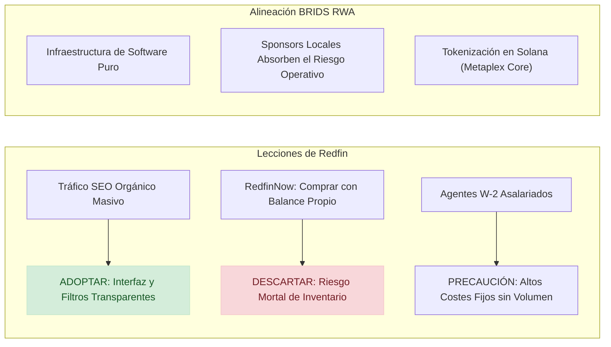

# Benchmark Estratégico Redfin vs BRIDS: Corretaje de Descuento, Cierre de RedfinNow, Economía de Portal SEO y Desafíos de Adquisición

> [!NOTE]
> **Propósito de Investigación Objetiva:** Redfin Corporation (NASDAQ: RDFN) representa uno de los experimentos más sofisticados de la PropTech: combinar un portal de búsqueda inmobiliaria con más de 50 millones de usuarios activos con una correduría propia de comisiones reducidas (1%–1.5%) y agentes en nómina (W-2). Este análisis examina las lecciones de su modelo de captación SEO, las causas empíricas del cierre de su división iBuying (*RedfinNow*) en noviembre de 2022, y los retos estructurales de distribución que BRIDS debe afrontar sin caer en el sesgo de confirmación.

---

## 1. Qué Logró Redfin: Innovación Real y Ventajas Competitivas

1. **La Máquina de Tráfico Orgánico SEO Más Eficiente del Sector:** Redfin demostró que ser pionero en la sindicación directa de datos de MLS locales en mapas interactivos rápidos genera un foso defensivo de tráfico orgánico casi gratuito. A diferencia de portales que gastan cientos de millones en publicidad televisiva o Google Ads, Redfin genera más de **50 millones de visitantes mensuales** con un coste de adquisición de cliente (CAC) drásticamente inferior a la media de la industria.
2. **El Modelo de Corretaje con Comisión Reducida (1.0%–1.5%):** Redfin desafió el cártel tradicional de comisiones del 5%–6% en EE.UU., ofreciendo a los propietarios publicar su inmueble por una tarifa de cotización (*listing fee*) de solo el **1.5%** (o **1.0%** si el cliente también compra su siguiente vivienda a través de Redfin). Este modelo ha ahorrado a los consumidores más de **\$1,500 millones de dólares en comisiones** desde su fundación.
3. **Integración Vertical de Servicios Conexos (*Attach Rates*):** A través de la adquisición de *Bay Equity Home Loans* en 2022 (\$135 millones) y su filial de títulos *Title Forward*, Redfin logró conectar en una sola plataforma la búsqueda de la vivienda, la intermediación del agente, la originación de la hipoteca y el seguro de título.

---

## 2. La Autopsia del Cierre de RedfinNow (Noviembre 2022)

A pesar de contar con el segundo portal con mayor tráfico de EE.UU. (proporcionando un flujo constante y gratuito de propietarios solicitando valoraciones), Redfin fracasó rotundamente al intentar operar un negocio de balance (*iBuying*).

### A. El Memorando Histórico del CEO Glenn Kelman (9 de Noviembre de 2022)
El 9 de noviembre de 2022, el CEO de Redfin, **Glenn Kelman**, envió un comunicado interno a toda la compañía anunciando el despido de **862 empleados (13% de la plantilla)** y la liquidación total de RedfinNow ([GeekWire Report](https://www.geekwire.com/2022/redfin-to-shut-down-ibuying-business-and-lay-off-13-of-staff-as-housing-market-slumps/) / [Business Insider Memo Coverage](https://www.businessinsider.com/redfin-lays-off-employees-shuts-down-redfinnow-glenn-kelman-memo-2022-11)):

> *"Querido equipo de Redfin: Estamos despidiendo a 862 personas brillantes y leales, y además cerrando definitivamente RedfinNow... Operar iBuying requiere una cantidad asombrosa de capital y riesgo para un beneficio ahora totalmente incierto. Tener cientos de millones de dólares inmovilizados en casas que tú mismo no querrías poseer en este momento no es el camino para nuestra compañía."*  
> — **Glenn Kelman**, CEO de Redfin Corporation ([Kelman Public Shareholder Letter](https://www.redfin.com/news/november-2022-layoff-update/)).

### B. Las Causas Financieras del Cierre en el Formulario 10-K ante la SEC
En su reporte anual auditado ante la SEC ([SEC Form 10-K FY 2022, Redfin Corp CIK #0001382873](https://www.sec.gov/ix?doc=/Archives/edgar/data/1382873/000138287323000012/rdfn-20221231.htm)):
* **Pérdida Operativa del Segmento Properties:** En 2022, antes de computar gastos generales corporativos y costes de personal central, el segmento de viviendas en balance (RedfinNow) generó una pérdida bruta de **\$(22.7) millones de dólares**, con un ajuste por desvalorización de inventario (*inventory write-down*) de **\$18.3 millones de dólares**.
* **Pérdida Neta Consolidada Récord:** Redfin registró una pérdida neta GAAP de **\$(321.1) millones de dólares en 2022**, frente a \$(109.6) millones en 2021.
* **El Hallazgo de Kelman sobre el Arbitraje:** Kelman reconoció que cuando el mercado inmobiliario sube, cualquier intermediario parece un genio; pero cuando las tasas hipotecarias se duplicaron en 2022 (del 3.2% al 7.1%), el iBuyer se convierte en un acumulador de activos depreciados que devora el margen del negocio central de software.

---

## 3. Métricas Financieras Auditadas: SEC Form 10-K (2021–2023)

Fuente: Comisión de Bolsa y Valores de EE.UU. ([SEC EDGAR: Redfin Corporation CIK #0001382873](https://www.sec.gov/edgar/browse/?CIK=0001382873)):

| Métrica Consolidada | FY 2021 (10-K) | FY 2022 (10-K) | FY 2023 (10-K) | Observaciones Auditadas |
| :--- | :--- | :--- | :--- | :--- |
| **Ingresos Totales (Revenue)** | \$1,923M | \$2,284M | \$977M | Caída de **-57.2%** en 2023 al eliminar RedfinNow |
| **Ingresos del Segmento Properties (iBuying)** | \$881M | \$1,363M | \$0M | Liquidación y salida total del negocio de inventario |
| **Ingresos de Corretaje Real Estate** | \$900M | \$762M | \$653M | Contracción por el congelamiento del mercado de compraventa |
| **Pérdida Bruta de RedfinNow** | +\$10.3M | \$(22.7)M | \$0M | Cierre forzado para evitar sangría de caja |
| **Pérdida Neta Consolidada GAAP** | \$(109.6)M | \$(321.1)M | \$(130.0)M | **\$(560.7)M acumulados** en 3 ejercicios |
| **Carga de Deuda Convertible** | \$1,245M | \$1,148M | \$872M | Renegociaciones y recompras con descuento |

---

## 4. Análisis Crítico de Mike DelPrete sobre Redfin

El analista de tecnología inmobiliaria **Mike DelPrete** ha seguido de cerca la trayectoria de Redfin ([Mike DelPrete Analysis on Redfin's Profitability](https://www.mikedp.com)):
1. **La Paradoja del Embudo Gratuito:** Zillow y Redfin demostraron que ni siquiera teniendo el tráfico web más barato del planeta se puede rentabilizar el negocio de comprar y vender viviendas en balance propio. El problema no era el coste de captación, sino la naturaleza ilíquida e intensiva en capital del activo inmobiliario.
2. **La Vulnerabilidad de las Grandes Adquisiciones:** Redfin pagó \$608 millones en efectivo y acciones por *RentPath* (sitios de alquiler como ApartmentGuide) en 2021, una operación que diluyó su capital y no aportó las sinergias esperadas, forzándola a reestructurar pasivos en 2023 y 2024.

---

## 5. Matriz Crítica: Qué Adoptar vs Qué Descartar para BRIDS

### ✅ Qué Debemos Adoptar de Redfin
* **Transparencia Radical en Datos y Calculadoras:** La interfaz de Redfin desglosa impuestos prediales históricos, cuotas de HOA, seguros y amortización con precisión matemática. BRIDS debe replicar esta transparencia en sus paneles de activos tokenizados (desglosando rentas netas, reserva de reparaciones y gastos de SPV).
* **Eficiencia de Contenido Educativo y SEO Local:** Redfin publica reportes mensuales del mercado inmobiliario basados en sus propios datos que son citados por los principales medios económicos mundiales, generando millones de backlinks orgánicos.

### ❌ Qué Debemos Descartar de Redfin
* **Intentar Operar como Intermediario de Balance:** La lección de Glenn Kelman es definitiva: una empresa de software jamás debe asumir la propiedad de los inmuebles.
* **Estructura Pesada de Personal Fijo (W-2) en Mercados Cíclicos:** Pagar sueldos fijos a cientos de peritos o agentes genera pérdidas operativas inmensas cuando el mercado inmobiliario se ralentiza.

---

## 6. Las Preguntas Difíciles que BRIDS Debe Responder (Contra-Tesis)

> [!WARNING] Desafíos Reales de Distribución y Red para BRIDS
> 1. **La Brecha de Captación (El Desafío del Tráfico):** Redfin puede lanzar cualquier producto digital porque ya tiene a 50 millones de compradores y vendedores en su portal cada mes. **BRIDS arranca con cero tráfico de inversores.** Si BRIDS no cuenta con un motor de descubrimiento orgánico masivo, ¿cuánto costará captar a cada inversor mediante paid marketing y cuál será su relación LTV/CAC real?
> 2. **La Resistencia de los Agentes Inmobiliarios Tradicionales:** El 88% de las transacciones inmobiliarias en EE.UU. siguen involucrando a agentes tradicionales. Redfin fue boicoteada durante años por corredores locales por reducir comisiones. Si BRIDS propone sindicación fraccionada directa eliminando corredores tradicionales, **¿cómo evitará que los grandes brokers desaconsejen a sus clientes colocar activos en la plataforma?**
> 3. **La Fricción de Adopción Web3 para Inversores Inmobiliarios:** Redfin permite operar con transferencias bancarias ACH convencionales y firmas DocuSign en 2 minutos. Si BRIDS exige billeteras de Solana (Phantom/Solflare), gestión de claves privadas o transferencias de USDC, creará una barrera de conversión inmensa para el inversor inmobiliario tradicional. Es obligatorio abstraer la blockchain con inicio de sesión Web2 y pasarelas de pago fiduciario transparentes.
